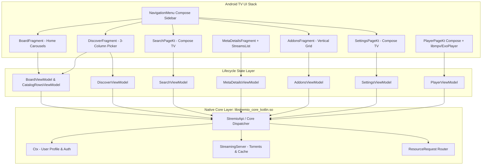

# Stremio Android TV (`com.stremio.one`) Component Architecture Specification

> **Target Analysis Artifact:** Reverse-engineered inspection of Stremio Android TV APK (`v1.11.2-40000002`).  
> **Source Material:** Decompiled Kotlin/Java source classes located in [`analysis/components/`](file:///d:/Vibe%20Coding%20Projects/REA/analysis/components).

---

## 1. Executive Summary & Component Breakdown

Stremio Android TV represents a hybrid architecture:
1. **Core State & Data Layer:** A native Rust engine packaged as `libstremio_core_kotlin.so` exposing state streams (`stremioApi.ctx()`, `Catalog`, `StreamingServer`, `Addons`, `Discover`, etc.) through JNI.
2. **Modern Presentation Layer:** Split between **Jetpack Compose for TV** (`SearchPageKt`, `PlayerPageKt`, `NavigationMenuKt`, `SettingsPageKt`, `UserProfilesPageKt`) and **AndroidX Leanback** (`DiscoverFragment`, `BoardFragment`, `AddonsFragment`, `MetaDetailsFragment`, `StreamsListFragment`, `CatalogRowsController`).
3. **Media Pipeline:** Modular playback abstraction (`Player.java`) with backends for `ExoPlayer`, `VlcPlayer`, and `MpvPlayer` (via `dev.jdtech.mpv.MPVLib` -> `libmpv.so`).



---

## 2. Catalog Discovery Component (`DiscoverFragment`, `DiscoverViewModel`)

### 2.1 UI Layout & Interaction Model
- **Class:** [`com.stremio.tv.views.discover.DiscoverFragment`](file:///d:/Vibe%20Coding%20Projects/REA/analysis/components/DiscoverFragment.java)
- **ViewModel:** [`com.stremio.common.viewmodels.DiscoverViewModel`](file:///d:/Vibe%20Coding%20Projects/REA/analysis/components/DiscoverViewModel.java)
- **Layout:** `R.layout.fragment_discover` containing:
  - `discover_picker` (`androidx.leanback.widget.picker.Picker`): 3-column selector with separators `"⋮"`.
  - `catalog_rows_fragment` (`CatalogRowsFragment`): Horizontal media carousel container.

### 2.2 Picker Column Indices & Filter Pipeline
```
[ Column 0: TYPE ]      [ Column 1: CATALOG ]     [ Column 2: GENRE / EXTRA ]
(Movies, Series, Anime)  (Popular, Top, Year, etc.) (Action, Comedy, Sci-Fi...)
```
- **Column 0 (`TYPE_COLUMN_INDEX = 0`):** Iterates over `DiscoverState.types`. Selecting an item extracts `types[val].getRequest()`.
- **Column 1 (`CATALOG_COLUMN_INDEX = 1`):** Iterates over `DiscoverState.catalogs`. Selecting an item extracts `catalogs[val].getRequest()`.
- **Column 2 (`GENRE_COLUMN_INDEX = 2`):** Iterates over `DiscoverState.genres.options`. Selecting an item extracts `options[val].getRequest()`.

### 2.3 State Flow & D-pad Handling
1. **Catalog Query Dispatch:** When any column changes (`onValueChanged`), `onViewCreated$lambda$1` fires:
   ```java
   ResourceRequest request = selectedOption.getRequest();
   discoverViewModel.loadCatalog(request);
   ```
2. **Result Projection:** `DiscoverState.getCatalog()` emits into `CatalogRowsViewModel`:
   ```java
   rowsViewModel.onEvent(new RowsEvent.LoadRows([new MetaRow.CatalogRow(catalog, ...)]));
   ```
3. **Back Key Trapping:** `DiscoverFragment$backPressedCallback$1` traps Back: if `picker.isActivated()` is true, it collapses the picker instead of navigating back.

---

## 3. Home Board & Horizontal Carousels (`BoardFragment`, `CatalogRowsController`)

### 3.1 UI Composition
- **Class:** [`com.stremio.tv.views.board.BoardFragment`](file:///d:/Vibe%20Coding%20Projects/REA/analysis/components/BoardFragment.java)
- **Controller:** [`com.stremio.tv.views.metarow.CatalogRowsController`](file:///d:/Vibe%20Coding%20Projects/REA/analysis/components/CatalogRowsController.java)
- **Layout Engine:** Built on `jp.co.cyberagent.lounge.LoungeController` using `FixedStartListRowPresenter` with header styling (`CatalogRowsHeader`).

### 3.2 Row Hierarchies & Data Models
The home board transforms `BoardState` into heterogeneous `MetaRow` instances:
1. **Continue Watching Row:**
   - **Model:** `MetaRow.ContinueWatchingRow` -> `ContinueWatchingItemModel`.
   - **Source:** `boardState.getContinueWatching()` containing `LibraryItem` objects with watch progress (`progress`, `duration`, `lastWatched`).
2. **Add-on Catalog Rows:**
   - **Model:** `MetaRow.CatalogRow` -> `MetaItemModel`.
   - **Source:** Addon catalog streams (`boardState.getCatalogs()`).
   - Supports paginated lazy fetching (`LoadablePage`), item deduplication by ID, and state wrappers:
     - `CatalogLoadingModel`: Rendered while an addon response is pending.
     - `CatalogErrorModel`: Rendered if an addon server returns an error or times out.
3. **Announcements Modal:**
   - Subscribes to `AnnouncementsViewModel.getState()`. When an unread announcement arrives, inflates `DialogAnnouncementBinding` as an `AlertDialog`.

---

## 4. Search & Voice Integration (`SearchPageKt`, `SearchViewModel`)

### 4.1 UI Architecture
- **Composables:** [`com.stremio.tv.views.search.SearchPageKt`](file:///d:/Vibe%20Coding%20Projects/REA/analysis/components/SearchPageKt.java)
- **ViewModel:** [`com.stremio.common.viewmodels.SearchViewModel`](file:///d:/Vibe%20Coding%20Projects/REA/analysis/components/SearchViewModel.java)
- **Framework:** 100% Jetpack Compose for TV.

### 4.2 Search Sub-Components
1. **`SearchFieldKt.SearchField`:**
   - TV-optimized text input with focus highlight, virtual keyboard launcher, and `autoFocus(true)`.
   - Direction down (`Key.DirectionDown`) navigates focus from the search box directly to the first row of results.
2. **`History`:**
   - Displayed when the query is empty.
   - Shows chip list of recent search queries with an `onClear` option.
3. **`MetaPreviewKt.MetaPreview`:**
   - Dynamic top header showing poster, synopsis, ratings, and genre tags for the *currently focused* search result item.
4. **`CatalogRowsKt.CatalogRows`:**
   - Horizontal carousels displaying search matches aggregated across all installed catalogs (Movies, Series, YouTube, etc.).
   - Direction up (`Key.DirectionUp`) from row 0 shifts focus back into the `SearchField`.

---

## 5. Add-on Management (`AddonsFragment`, `AddonDetailsViewModel`)

### 5.1 UI Layout
- **Class:** [`com.stremio.tv.views.addons.AddonsFragment`](file:///d:/Vibe%20Coding%20Projects/REA/analysis/components/AddonsFragment.java)
- **Controller:** [`com.stremio.tv.views.addons.AddonsController`](file:///d:/Vibe%20Coding%20Projects/REA/analysis/components/AddonsController.java)
- **Grid View:** `VerticalGridSupportFragment` with `FixedCenterVerticalGridPresenter(columns = 1)`.

### 5.2 Add-on Filtering & Installation
1. **Picker Filtering:**
   - Column 0: Catalog (`Official`, `Community`, etc.).
   - Column 1: Type (`All`, `Movies`, `Series`, `Anime`, `Subtitles`, `Other`).
2. **Manual Addon Installation:**
   - `add_addon_button` opens an `AlertDialog` with a `TextInputLayout` prompting for `transportUrl` (e.g. `https://torrentio.strem.fun/manifest.json`).
   - Dispatches navigation: `actionToAddonDetails(transportUrl)`.
3. **Addon Descriptor Card:**
   - Renders `DescriptorModel`: Name, description, icon, version, author, and installation status badge.
   - Selecting a card navigates to `AddonDetailsFragment` to inspect manifest permissions or toggle install/uninstall.

---

## 6. MetaDetails & Stream Selection (`MetaDetailsFragment`, `StreamsListFragment`)

### 6.1 Layout & Action Hierarchy
- **Class:** [`com.stremio.tv.views.metadetails.MetaDetailsFragment`](file:///d:/Vibe%20Coding%20Projects/REA/analysis/components/MetaDetailsFragment.java)
- **Binding:** `FragmentMetaDetailsBinding`
- **Actions:**
  - `metaDetailBtnTrailer`: Plays trailer via `trailerStream.getDeepLinks().getPlayer()`.
  - `metaDetailBtnLibrary`: Dispatches `MetaDetailsEvent.ToggleInLibrary`.
  - `metaDetailBtnWatched`: Dispatches `MetaDetailsEvent.ToggleWatched`.
  - `metaDetailBtnToggleNotifications`: Subscribes/unsubscribes from new episode notifications.
  - `metaDetailBtnRateLike` / `metaDetailBtnRateLove`: Sends rating events (`Rating.LIKED` / `Rating.LOVED`).

### 6.2 Stream Selection Pipeline (`StreamsListFragment`, `StreamsController`)
- **Class:** [`com.stremio.tv.views.metadetails.streams.StreamsListFragment`](file:///d:/Vibe%20Coding%20Projects/REA/analysis/components/StreamsListFragment.java)
- **Stream Model:** `StreamModel` items parsed from `metaDetailsState.getStreams()`.
- **Item Badges:** Resolution (4K, 1080p, 720p), HDR/Dolby Vision, audio codec, seeder count, file size, source addon name.
- **Autoplay Handling:**
  ```java
  // In StreamsListFragment.java
  FlowKt.launchIn(FlowKt.onEach(FlowKt.filterNotNull(
      FlowExtKt.flowWithLifecycle(viewModel.getAutoPlayStream(), ...)),
      stream -> navigateToStream(stream)
  ));
  ```
- **Player Dispatch:**
  ```java
  private final void navigateToStream(Stream stream) {
      NavController navController = FragmentKt.findNavController(this);
      Uri uri = Uri.parse(stream.getDeepLinks().getPlayer());
      navController.navigate(uri);
  }
  ```

---

## 7. Navigation Sidebar & App State (`NavigationMenuKt`, `SettingsPageKt`)

### 7.1 Sidebar Navigation Drawer
- **Class:** [`com.stremio.tv.views.menu.NavigationMenuKt`](file:///d:/Vibe%20Coding%20Projects/REA/analysis/components/NavigationMenuKt.java)
- **Fixed Routes (`MAIN_ROUTES`):**
  1. `R.id.search` (Search Page)
  2. `R.id.board` (Home Board)
  3. `R.id.discover` (Catalog Discover)
  4. `R.id.library` (My Library)
  5. `R.id.addons` (Add-on Management)
  6. `R.id.settings` (Settings)
- **Dynamic Profile Header:** Displays avatar, Stremio account tier, and active profile selector (`UserProfilesPageKt`).

### 7.2 Settings Categorization (`SettingsPageKt`, `SettingsViewModel`)
- **Categories:**
  - `General`: Language overrides, UI scaling, data privacy.
  - `Playback`: Auto-play next episode, default player engine (`ExoPlayer` / `VlcPlayer` / `MpvPlayer`), hardware acceleration.
  - `Audio`: Preferred audio language, digital sound pass-through (bitstream AC3/DTS).
  - `Subtitles`: Default subtitle language, auto-load subtitles, font size, color, background opacity, vertical position offset.
  - `Streaming Server`: Torrent profile presets (`DEFAULT`, `SOFT`, `FAST`, `ULTRA_FAST`), disk cache size limit (`updateCacheSize`), streaming port.
  - `About`: App build version, core version, legal attribution.

---

## 8. Summary of Adaptation Requirements for Bazzite Linux / Flatpak

| Component | Android TV APK Implementation | Bazzite TV Flatpak Parity Implementation |
|---|---|---|
| **Catalog Discovery** | 3-Column `Picker` + `CatalogRowsFragment` | `tv.strem.io` Discover view (D-pad navigable via keyboard events) |
| **Home Board** | `BoardFragment` + `CatalogRowsController` | `tv.strem.io` Board view (Continue Watching + Addon Rows) |
| **Search** | `SearchPageKt` (Compose TV) | `tv.strem.io` Search (On-screen keyboard + Steam Deck virtual keyboard) |
| **Addon Manager** | `AddonsFragment` + Custom URL dialog | `tv.strem.io` Addon Manager + URL install modal |
| **MetaDetails & Streams** | `MetaDetailsFragment` + `StreamsListFragment` | `tv.strem.io` Detail view + Stream selector list |
| **Player Pipeline** | `MpvPlayer` via JNI `dev.jdtech.mpv` | `stremio-linux-shell` with native `libmpv` (Wayland / VAAPI / Vulkan) |
| **IPC Bridge** | Kotlin Coroutines to `StremioApi` | WebKit `window.ipc` / `ShellVideo` via `preload.js` |
| **Controller Input** | Android TV D-pad KeyEvents (`KEYCODE_DPAD_*`) | Gamepad API to KeyboardEvent mapping (`Arrow*`, `Enter`, `Escape`) |
