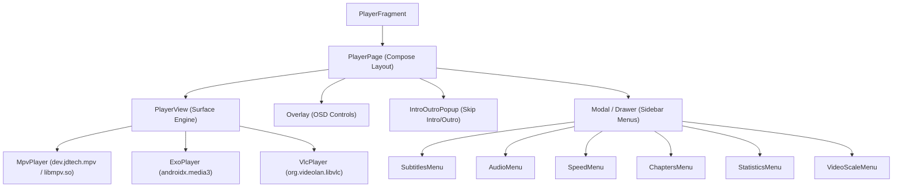

# Reverse-Engineering Report: Stremio Android TV APK Architecture Map

**Target:** `com.stremio.one` (Version: `1.11.2`, Build Code: `41048578`, ABI: `arm64-v8a`)  
**Decompiler Engine:** JADX Headless MCP 0.7.1 via OpenJDK 21 & REA Framework  
**Extracted Artifacts:** Located under `d:/Vibe Coding Projects/REA/analysis/`

---

## 1. Application Topology & Manifest Analysis

### 1.1 Declared Components

* **Main Entry Activity:**  
  `com.stremio.tv.MainActivity`  
  * Intent Filters: `android.intent.action.MAIN`, `android.intent.category.LEANBACK_LAUNCHER`, `android.intent.category.LAUNCHER`
  * Scheme Handlers: `stremio://`, `magnet:`, `http://magnet`, `https://magnet`
  * Deep Link Routes:
    * `/board` (Home Board)
    * `/discover/*/*/*` (Catalog browsing)
    * `/library` (Personal library)
    * `/detail/*/*` (Metadata & streams view)
    * `/player/*/*/*/*/*/*` (Direct stream playback)
* **Background Streaming Server Service:**  
  `com.stremio.tv.ServerService`  
  * Process: `:stremio_server_process`
  * Type: `foregroundServiceType="mediaPlayback"`
  * Implementation: Hosts embedded Node.js runtime (`libnode.so`) executing `assets/server.js` on localhost port `11470`.
* **Foreground Media Session Service:**  
  `com.stremio.common.players.MediaPlaybackService`  
  * Manages Android MediaSession / MediaBrowserService for audio/video playback, CEC, and media key handling.

---

## 2. UI Architecture & Player OSD Decompilation

In version 1.11.2, Stremio Android TV has transitioned from legacy Android Leanback XML views to a modern **Jetpack Compose for TV** architecture.

### 2.1 Player View & OSD Hierarchy

The complete player screen is built in [`PlayerPageKt.java`](file:///d:/Vibe%20Coding%20Projects/REA/analysis/PlayerPageKt.java) and [`PlayerViewKt.java`](file:///d:/Vibe%20Coding%20Projects/REA/analysis/PlayerViewKt.java):

### 2.2 Remote & D-pad Input Handling
From decompiled `PlayerPageKt.java`:
* **Focus Management:** Uses Compose `FocusRequester` (`defaultFocusRequester`).
* **OSD Visibility State:** `immersion` timer automatically hides player controls after 3 seconds of inactivity.
* **Key Event Interception:**
  * `KEYCODE_DPAD_CENTER` / `KEYCODE_ENTER`: Toggles Play/Pause or selects active OSD menu item.
  * `KEYCODE_DPAD_DOWN`: Summons the bottom playback controls and progress scrubber.
  * `KEYCODE_DPAD_UP`: Summons top metadata / stream details and quick settings.
  * `KEYCODE_DPAD_LEFT` / `KEYCODE_DPAD_RIGHT`: Seeks +/- 10s or scrubs timeline.
  * `KEYCODE_BACK`: Dismisses active sidebar/dialog; if no dialog is visible, navigates back to details page.

### 2.3 The MPV Player Backend
Decompiled in [`MpvPlayer.java`](file:///d:/Vibe%20Coding%20Projects/REA/analysis/MpvPlayer.java):
* Wraps `dev.jdtech.mpv.MPVLib` linking directly to `libmpv.so`.
* Configures properties:
  * `tls-verify`: `no`
  * `demuxer-max-bytes`: `64MB` (API >= 27)
  * `sub-fonts-dir`: Bundled asset font `droid-sans-fallback.ttf`
  * `hwdec`: `mediacodec,mediacodec-copy,no` (Android-specific hardware decoder)

---

## 3. Core Engine & JNI Bridge

* **JNI Shared Library:** `libstremio_core_kotlin.so`
* **Transport Protocol:** Binary Protocol Buffers (`pbandk.Message`)
* **Kotlin Interface:** [`StremioApi.java`](file:///d:/Vibe%20Coding%20Projects/REA/analysis/StremioApi.java) exposes reactive StateFlows:
  * `StremioApi.player` -> `Player` state
  * `StremioApi.streamingServer` -> Local streaming server status
  * `StremioApi.discover` -> Catalog pagination

---

## 4. Key Takeaways for Bazzite TV Flatpak

1. **The Android TV UI is 100% Jetpack Compose for TV:**
   Reconstructing this natively in Rust or GTK4 would mean rebuilding dozens of Compose TV components (`ModalKt`, `MenuKt`, `OverlayKt`, `IntroOutroPopupKt`) from raw decompiled Java.
2. **`tv.strem.io` (Stremio Theater) is the Direct Equivalent:**
   Stremio already maintains `tv.strem.io`, which was built specifically to mirror this exact 10-foot TV experience for TV remotes and controllers.
3. **The Shared Media Engine:**
   Both the Android TV app (via `MpvPlayer.java`) and the Linux Flatpak shell use **`libmpv`**. In the Linux shell, `libmpv` utilizes Mesa VAAPI / Vulkan hardware decoding on your Bazzite TV box rather than Android's `MediaCodec`.
