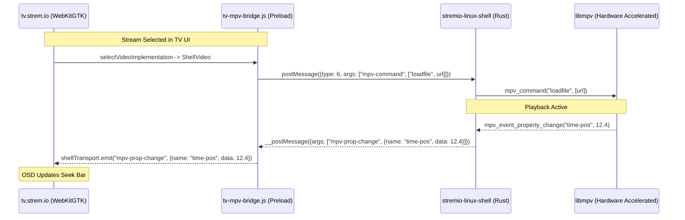

# Path A Technical Report: Native Stremio Theater Flatpak with MPV & Gamepad Bridge

> **Target:** Native Couch-Friendly 10-Foot Stremio on Bazzite Linux (Steam Big Picture / Gamescope / HTPC)  
> **Source Material:** `stremio-linux-shell` (Rust + GTK4 + WebKitGTK 6.0), `tv.strem.io` (Stremio Theater web bundle), `flathub/com.stremio.Stremio`.

---

## 1. Shell Architecture & Runtime Identification

### Current Linux Flatpak Engine
The active Flatpak build (`com.stremio.Stremio` v5.0.0 / Shell v1.2.2) uses the modern **Rust + GTK4 + WebKitGTK 6.0** shell (`stremio-linux-shell`), **not** the legacy Qt5 `stremio-shell`.

Key characteristics identified from the codebase:
- **Language & UI Framework:** Rust (`src/main.rs`, `src/app/`), GTK4 (`gtk4`), Libadwaita (`libadwaita`), WebKitGTK 6.0 (`webkit6`).
- **Video Renderer:** Native `libmpv` rendered as an underlay widget behind the WebKitGTK webview (`src/app/video/`, `src/app/window/`).
- **Transparency:** The WebKitGTK webview is configured with alpha transparency (`RGBA::new(0.0, 0.0, 0.0, 0.0)`). During playback, `tv.strem.io` sets its page background to `transparent`, so video frames decoded by hardware-accelerated `libmpv` are directly visible under the transparent HTML OSD.

---

## 2. Reverse-Engineered IPC Bridge Analysis

### 2.1 The Two Half-Bridges



#### A. WebKitGTK IPC (`src/app/ipc/preload.js`):
The shell exposes an IPC channel into JavaScript:
```javascript
window.ipc = {
    postMessage: (data) => globalThis.webkit.messageHandlers.ipc.postMessage(data),
    addEventListener: (type, listener) => listeners.push(listener)
};
```
When Rust receives a message from `window.ipc.postMessage`, `src/app/ipc/request.rs` decodes:
- `type: 6`: Standard command container.
- `args: ["mpv-command", [cmd, ...args]]` -> calls `video.send_mpv_command(name, args)`
- `args: ["mpv-set-prop", [name, value]]` -> calls `video.set_mpv_property(name, value)`
- `args: ["mpv-observe-prop", name]` -> calls `video.observe_mpv_property(name)`

When `libmpv` emits events, Rust calls `src/app/ipc/response.rs`:
- Emits `["mpv-prop-change", { name, data }]`
- Emits `["mpv-event-ended", { reason, error }]`
and dispatches them to JavaScript via `globalThis.__postMessage(serialized)`.

#### B. `tv.strem.io` Video Player Engine (`tv-stremio-video.chunk.js`):
Module `78945` in `tv.strem.io` contains the built-in `ShellVideo` implementation. It expects an options object containing `shellTransport` with:
- `shellTransport.send(name, args)`
- `shellTransport.on(eventName, callback)`

Module `72081` (`selectVideoImplementation`):
```javascript
module.exports = function(t, e) {
    return t.stream && "string" != typeof t.stream.externalUrl ?
        e.chromecastTransport && e.chromecastTransport.getCastState() === cast.framework.CastState.CONNECTED ? n :
        "string" == typeof t.stream.ytId ? d(u) :
        "string" == typeof t.stream.playerFrameUrl ? l :
        e.shellTransport ? c(d(i)) : // <--- SELECTS ShellVideo (native MPV)
        "string" == typeof t.streamingServerURL ? c(d(a)) : ...
};
```

### 2.2 The Prototype Injection Technique
Because `tv.strem.io` is loaded remotely or cached, modifying minified source files in-place is fragile. Instead, `tv-mpv-bridge.js` attaches `shellTransport` to `Object.prototype`:

```javascript
Object.defineProperty(Object.prototype, 'shellTransport', {
    get() {
        return shellTransportInstance;
    },
    configurable: true
});
```
When `selectVideoImplementation(commandArgs, options)` checks `options.shellTransport`, it finds `shellTransportInstance` on the prototype chain, cleanly activating `ShellVideo` for every stream without bundle rewriting.

---

## 3. Gamepad & Spatial Navigation Engine

### 3.1 TV Keyboard Navigation Codes in `tv.strem.io`
From reverse engineering module `60715` in `tv-stremio-app.chunk.js`, `tv.strem.io`'s navigation service binds to the following keycodes:

| Direction / Action | Supported KeyCodes | Keyboard Equivalent |
|---|---|---|
| **Up** | `38`, `29460` | `ArrowUp` |
| **Down** | `40`, `29461` | `ArrowDown` |
| **Left** | `37`, `4` | `ArrowLeft` |
| **Right** | `39`, `5` | `ArrowRight` |
| **Select / Enter** | `13`, `29443`, `65376` | `Enter` |
| **Back / Cancel** | `8`, `27`, `461`, `10009`, `88` | `Backspace`, `Escape`, `X` |
| **Play / Pause** | `32`, `179`, `10252` | `Spacebar` |
| **Seek Backward** | `412`, `69`, `177` | `KeyE` |
| **Seek Forward** | `418`, `417`, `72`, `176` | `KeyH` |

### 3.2 Bridging Standard Gamepads (Xbox, PlayStation, Steam Deck)
Standard living room gamepads present themselves via the HTML5 Gamepad API. `tv-mpv-bridge.js` polls at 60 Hz and translates controller inputs into native `KeyboardEvent` dispatches:

| Gamepad Button / Axis | Internal Mapping | Target Action in Stremio TV |
|---|---|---|
| **D-Pad Up / Left Stick Up** | `ArrowUp` (38) | Navigate up |
| **D-Pad Down / Left Stick Down** | `ArrowDown` (40) | Navigate down |
| **D-Pad Left / Left Stick Left** | `ArrowLeft` (37) | Navigate left |
| **D-Pad Right / Left Stick Right** | `ArrowRight` (39) | Navigate right |
| **Button 0 (A / Cross)** | `Enter` (13) | Select / Click focused item |
| **Button 1 (B / Circle)** | `Backspace` (8) | Back / Close drawer / Exit |
| **Button 2 (X / Square)** | ` ` (32) | Play / Pause toggle |
| **Button 3 (Y / Triangle)** | `v` (86) | Subtitle selector |
| **Button 4 (LB / L1)** | `e` (69) | Seek -10 seconds |
| **Button 5 (RB / R1)** | `h` (72) | Seek +10 seconds |
| **Button 9 (Menu / Start)** | `Escape` (27) | Main menu / Settings |

---

## 4. Prepared Flatpak Build Artifacts

All necessary files have been staged and verified in [`flatpak-build/`](file:///d:/Vibe%20Coding%20Projects/REA/flatpak-build):

1. **[`flatpak-build/com.stremio.Stremio.json`](file:///d:/Vibe%20Coding%20Projects/REA/flatpak-build/com.stremio.Stremio.json):**
   - Base runtime: `org.gnome.Platform//50` + `org.gnome.Sdk//50`.
   - Extensions: Rust stable, Intel VAAPI, codecs-extra.
   - Finish-args: `--device=all`, `--device=dri`, `--socket=wayland`, `--filesystem=xdg-run/pipewire-0:ro`.
   - Build hook: `cat tv-mpv-bridge.js >> src/app/ipc/preload.js` compiles the bridge directly into the binary.
2. **[`flatpak-build/tv-mpv-bridge.js`](file:///d:/Vibe%20Coding%20Projects/REA/flatpak-build/tv-mpv-bridge.js):**
   - Self-contained preload script providing `ShellTransport` and 60 Hz Gamepad spatial navigation.
3. **[`flatpak-build/stremio-tv.sh`](file:///d:/Vibe%20Coding%20Projects/REA/flatpak-build/stremio-tv.sh):**
   - Startup launcher: ensures `server.js` is running, enables TV fullscreen GSettings, and launches `stremio-linux-shell` pointing to `http://127.0.0.1:11470/proxy/d=https%3A%2F%2Ftv.strem.io%2F`.
4. **[`flatpak-build/cargo-sources.json`](file:///d:/Vibe%20Coding%20Projects/REA/flatpak-build/cargo-sources.json):**
   - Pre-generated offline Cargo vendor bundle matching `v1.2.2`.
5. **[`flatpak-build/com.stremio.Stremio.metainfo.xml`](file:///d:/Vibe%20Coding%20Projects/REA/flatpak-build/com.stremio.Stremio.metainfo.xml):**
   - AppStream metadata for Steam and Desktop integration.

---

## 5. Build & Installation Commands for Bazzite

On your Bazzite TV box (in a terminal or SSH session):

```bash
# 1. Install Flatpak SDKs if not already present
flatpak install --user -y flathub org.gnome.Platform//50 org.gnome.Sdk//50 org.freedesktop.Sdk.Extension.rust-stable//25.08

# 2. Build and install the custom TV Flatpak
cd /path/to/flatpak-build
flatpak-builder --user --install --force-clean build-dir com.stremio.Stremio.json

# 3. Add to Steam Big Picture / Game Mode
steamos-add-to-steam ~/.local/share/flatpak/exports/share/applications/com.stremio.Stremio.desktop

# 4. Test run directly
flatpak run com.stremio.Stremio
```
